  

  <strong>A lighter, cleaner, faster Windows.</strong> 
  An optimizer and debloater for Windows 10 and 11 that recommends tweaks built around your PC's hardware.

  <a href="https://github.com/Quarkium-Labs/Quarkium/releases/latest"><b>⬇ Download the latest version</b></a>
  &nbsp;·&nbsp;
  <a href="HTTP_???"><b>Buy a license</b></a>
  &nbsp;·&nbsp;
  <a href="#support">Support</a>

---

## What is Quarkium?

Quarkium is a Windows program that **analyzes your PC and applies optimizations made for it**: it removes what weighs your system down, cleans up what is left behind, and tunes Windows for your processor, graphics card, memory and drives.

Instead of a generic list of tweaks, it detects your hardware and **pre-selects what makes sense for your computer**. You review, confirm and apply. Whatever can be undone, you can undo from inside the program.

> **Paid product.** Quarkium is proprietary software and requires a License Key. See the terms in [LICENSE](LICENSE).

## What it does

### Optimizations
| Feature | Description |
|---|---|
| **Windows tweaks** | Around 30 tweaks organized by category: Privacy, CPU, GPU, RAM, SSD, HDD, Network, Services, Explorer and Debloat. The ones recommended for your hardware come pre-selected. |
| **Debloat** | Lists the apps that ship with Windows, sorted as suggested, optional, third-party or protected. You choose what to remove, with search and filters. Essential apps are locked. |
| **Disk cleanup** | Temporary files, Windows Update cache, DirectX shader cache, error reports, minidumps, Recycle Bin and DNS cache. Shows how much space will be freed before you clean. |
| **Free RAM** | Releases memory on demand with one click. |
| **Startup programs** | Turns on or off what launches with Windows, reversibly. |
| **Restore point** | Creates a Windows restore point before you apply changes. |

### Quarkium Speed
| Feature | Description |
|---|---|
| **Automatic RAM cleaner** | Frees memory on its own, by usage threshold or by time interval, using the rules you set. |
| **Game Mode** | Puts Windows in performance mode: power plan, reduced visual effects, Windows Game Mode on, background recording off and, if you want, RAM freed and processes closed. Everything is configurable. When you turn it off, Windows goes back to its original state, even if you closed Quarkium in the meantime. |
| **Deep clean** | Scans your drive and shows a folder tree sorted by size, so you can find what is taking up space and delete it. |
| **Processes** | Shows what runs in the foreground and background and lets you close what you don't need. |

### Quarkium Score
| Feature | Description |
|---|---|
| **Score test** | Measures CPU, RAM and disk in about 10 seconds and gives you a score from 0 to 1000. Compare it with your previous test to see the effect of your optimizations on **your** PC. |
| **Bottleneck diagnosis** | Watches your PC for a few seconds and shows what limits performance the most (disk, memory or CPU), plus weak points in your hardware. |

## Why Quarkium

- **Built around your hardware.** Recommendations change with your PC: what suits an SSD is not applied to an HDD, and what suits a desktop is not pre-selected on a laptop.
- **You stay in control.** Nothing is applied until you confirm, and medium-risk tweaks are never pre-selected.
- **Reversible.** Registry and service tweaks save the original value and can be undone from the interface. The program also offers to create a restore point before you start.
- **Built-in safeguards.** Quarkium refuses to delete critical system folders (such as `Windows`, `Program Files` and `Users`) and does not close essential Windows processes.
- **Confirmation for destructive actions.** Deleting files, closing processes and removing apps requires holding the button for 3 seconds, to prevent accidental clicks.
- **A single file.** Just download the `.exe` and open it. No need to install .NET or any other component.
- **Runs well on low-end PCs.** Pick the **Light** visual mode (no animations, minimal CPU and GPU use) or **Physics** (transitions, particles and animations), and switch whenever you like.
- **Three languages.** Interface in English, Português (BR) and Español.
- **Secure updates.** The app checks for new versions on its own and only installs updates that carry a valid digital signature.
- **Transparent.** Quarkium only connects to the internet for sign-in and license verification, and to check for updates.

## Requirements

- Windows 10 or Windows 11 (64-bit)
- Administrator permission (needed to change services and system settings)
- Internet connection for sign-in, activation and license verification
- A Google or Discord account to sign in, and a valid License Key

## Getting started

1. **Buy** your license at [HTTP_???](HTTP_???) and keep the License Key you receive.
2. **Download** `Quarkium.exe` from the [Releases](https://github.com/Quarkium-Labs/Quarkium/releases/latest) page.
3. **Open** the program as administrator, sign in with Google or Discord, and enter your License Key.
4. **Choose a visual mode** and, on the home screen, check the detected hardware.
5. **Create a restore point**, review the recommended optimizations and apply them.

> Download Quarkium only from this page. If Windows SmartScreen or your antivirus shows a warning on first run, that is common for programs that change system settings. Make sure the file came from this repository before you continue.

## License and activation

- Your License Key is tied to the account that activated it and to the number of computers included in your plan.
- The license is verified when the program starts and from time to time while it is in use.
- Changed computers? Contact support to release the old device.
- **Do not share your key.** Shared or resold keys may be revoked.

## Good practice and limits

- Test changes first, and use the restore point before applying many tweaks at once.
- **Removing preinstalled apps cannot be undone by Quarkium.** If you need an app back, reinstall it from the Microsoft Store. This is clearly marked in the program.
- Large Windows updates can undo some tweaks. Just apply them again.
- The "Free RAM" button temporarily reduces the memory used by processes. Windows already manages memory well, and the longer-lasting gain comes from turning off what you don't need to launch.
- Results vary from PC to PC. Use **Quarkium Score** to measure the difference on your own machine.

## Support

Need help with installation, activation or moving to a new computer?

- **Contact:** quarkium.group@proton.me

When asking for help, include your Quarkium version, your Windows version and, if there is one, the message shown on screen.

## License

Quarkium is proprietary software, licensed and not sold. Use is subject to the terms in the [LICENSE](LICENSE) file.

© 2026 Quarkium. All rights reserved. Quarkium and the Quarkium logo are trademarks of the owner.
